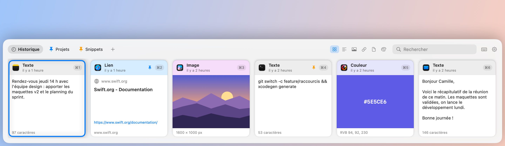
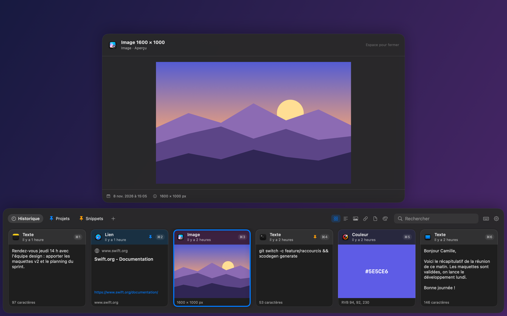

<p align="center">
  
</p>

<h1 align="center">Copicol</h1>

<p align="center">
  <strong>Un gestionnaire de presse-papiers natif et open source pour macOS.</strong><br>
  Tout ce que vous copiez, à un raccourci de distance.
</p>

<p align="center">
  <a href="https://github.com/romainrg/Copicol/releases/latest"></a><br>
  <sub>Gratuit et open source · macOS 14 ou ultérieur · Apple silicon et Intel</sub>
</p>

<p align="center"><a href="README.md">English version</a></p>

<picture>
  <source media="(prefers-color-scheme: dark)" srcset="docs/images/shelf-dark.png">
  
</picture>

Copicol garde l'historique de tout ce que vous copiez (textes, images, liens, fichiers, couleurs) et le fait revenir avec <kbd>⇧</kbd><kbd>⌘</kbd><kbd>V</kbd> : une étagère de cartes glisse depuis le bas de l'écran, vous en choisissez une, et elle est collée directement dans l'application que vous utilisiez.

## Fonctionnalités

- **Capture de tout ce que vous copiez** : texte brut et enrichi (RTF/HTML), images (PNG/TIFF), fichiers, liens web (avec titre et icône de la page) et couleurs (`#RGB`, `#RRGGBB`, `#RRGGBBAA`, ou une couleur copiée depuis un nuancier). Copier à nouveau un contenu le remonte en tête au lieu de le dupliquer.
- **Étagère** : un panneau qui glisse depuis le bas (ou le bord gauche ou droit) de l'écran actif. Naviguez avec les flèches, collez avec <kbd>↩</kbd> ou avec <kbd>⌘1</kbd>…<kbd>⌘9</kbd>.
- **Collage direct** dans l'application que vous utilisiez, tel quel ou en texte brut (<kbd>⇧↩</kbd>). Vous préférez coller vous-même ? Passez en mode « copier seulement ».
- **Recherche instantanée** dans les textes, titres de liens, URL, noms de fichiers et applications sources, sans tenir compte de la casse ni des accents, avec des filtres par type.
- **Pinboards** : des onglets colorés pour les éléments à garder. Glissez une carte sur un onglet pour l'épingler ; les éléments épinglés ne sont jamais purgés.
- **Aperçu** en grand avec <kbd>Espace</kbd>, **glisser-déposer** des cartes vers n'importe quelle application, partage par le menu de partage du système.
- **Respect de la vie privée** : tout reste sur votre Mac, sans compte ni statistiques d'usage. Les mots de passe signalés par les gestionnaires de mots de passe ne sont jamais enregistrés, et les copies faites dans 1Password, Bitwarden, Trousseau d'accès ou Mots de passe sont ignorées (liste configurable).
- **Natif et léger** : Swift, SwiftUI et AppKit, sandboxé, binaire universel (Apple Silicon et Intel), aucune dépendance tierce.
- **Synchronisation iCloud optionnelle** des pinboards et des petits éléments texte entre vos Mac, pour les builds signés avec une équipe de développement Apple (voir l'[architecture](docs/ARCHITECTURE.md#icloud-sync), en anglais).

<p align="center">
  
</p>

## Installation

1. Téléchargez `Copicol-<version>.dmg` depuis la [dernière version](https://github.com/romainrg/Copicol/releases/latest) et ouvrez-le.
2. Glissez **Copicol** sur le dossier **Applications**, éjectez l'image disque, puis ouvrez Copicol depuis `Applications`.
3. Copicol n'est pas encore notarisé par Apple : macOS bloque donc le premier lancement. Ouvrez **Réglages Système › Confidentialité et sécurité**, descendez et cliquez sur **Ouvrir quand même** à côté du message concernant Copicol. Ou bien, dans le Terminal :

   ```sh
   xattr -dr com.apple.quarantine /Applications/Copicol.app
   ```

4. Suivez la fenêtre d'accueil pour autoriser l'**Accessibilité**, nécessaire pour coller dans les autres applications. Copicol vit dans la barre des menus : il n'a pas d'icône dans le Dock.

Chaque version est accompagnée d'une somme de contrôle : `shasum -a 256 -c Copicol-<version>.dmg.sha256` vérifie votre téléchargement.

> [!IMPORTANT]
> Tant que Copicol n'est pas signé avec un Developer ID, macOS associe l'autorisation Accessibilité à chaque build. **Après une mise à jour**, retirez Copicol de Réglages Système › Confidentialité et sécurité › Accessibilité (bouton −) puis autorisez-le à nouveau.

**Configuration requise :** macOS 14 Sonoma ou plus récent.

## Utilisation

| Raccourci | Action |
|---|---|
| <kbd>⇧⌘V</kbd> (configurable) | Ouvrir ou fermer l'étagère |
| <kbd>←</kbd> <kbd>→</kbd> <kbd>↑</kbd> <kbd>↓</kbd> | Naviguer entre les cartes |
| <kbd>↩</kbd> | Coller l'élément sélectionné |
| <kbd>⇧↩</kbd> | Coller en texte brut |
| <kbd>⌘1</kbd> … <kbd>⌘9</kbd> | Coller le n-ième élément (<kbd>⇧</kbd> pour le texte brut) |
| <kbd>Espace</kbd> | Aperçu en grand |
| <kbd>⌦</kbd> (<kbd>fn</kbd> <kbd>⌫</kbd>) ou <kbd>⌘⌫</kbd> | Supprimer l'élément (<kbd>⌫</kbd> seul édite toujours la recherche) |
| <kbd>⌘C</kbd> | Copier sans coller |
| <kbd>⌘F</kbd> ou saisie directe | Rechercher |
| <kbd>⇥</kbd> / <kbd>⇧⇥</kbd> | Onglet suivant / précédent |
| <kbd>⎋</kbd> | Fermer l'aperçu, effacer la recherche, puis fermer l'étagère |

Clic droit sur une carte : coller, copier, épingler dans un pinboard, partager, aperçu ou supprimer. Double-clic sur un onglet de pinboard pour le renommer ; clic droit pour changer sa couleur ou le supprimer. L'icône de la barre des menus permet d'ouvrir l'étagère, de mettre la capture en pause, de vider l'historique et d'ouvrir les réglages.

### Autorisations

| Autorisation | Pourquoi | Où |
|---|---|---|
| **Accessibilité** | Simuler <kbd>⌘V</kbd> dans l'application active (collage direct). Inutile en mode « copier seulement ». | Réglages Système › Confidentialité et sécurité › Accessibilité |
| **Ouverture de session** | Lancer Copicol à la connexion (Réglages › Général). | Réglages Système › Général › Ouverture, si macOS le demande |
| **Accès au presse-papiers** | Les versions récentes de macOS peuvent demander l'autorisation avant qu'une app lise le presse-papiers. | Autoriser Copicol dans l'alerte |

Le raccourci global et la fermeture de l'étagère au clic extérieur ne demandent aucune autorisation.

## Vie privée

- L'historique est stocké uniquement sur votre Mac, dans le conteneur sandbox de Copicol (`~/Library/Containers/io.github.romainrg.Copicol/`).
- Les seules requêtes réseau concernent l'aperçu des liens : quand vous copiez un lien, Copicol charge le titre et l'icône de la page avec le framework LinkPresentation d'Apple, comme le fait Messages. Aucune statistique, télémétrie ni remontée de plantage.
- Le contenu du presse-papiers n'est jamais écrit dans les journaux.
- Les contenus que les autres applications marquent comme confidentiels ou temporaires (mots de passe, par exemple) ne sont jamais enregistrés. La capture peut être mise en pause à tout moment depuis la barre des menus.
- La synchronisation iCloud est désactivée par défaut et n'existe que dans les builds signés avec une équipe de développement Apple ; une fois activée, elle utilise votre base iCloud privée.

## Compiler depuis les sources

Prérequis : macOS 14 ou plus récent, Xcode 16 ou plus récent et [XcodeGen](https://github.com/yonaskolb/XcodeGen).

```sh
brew install xcodegen
git clone https://github.com/romainrg/Copicol.git
cd Copicol
xcodegen generate
xcodebuild -project Copicol.xcodeproj -scheme Copicol -configuration Debug -derivedDataPath build build
open build/Build/Products/Debug/Copicol.app
```

Tests : `xcodebuild test -project Copicol.xcodeproj -scheme Copicol -derivedDataPath build -destination 'platform=macOS'`. Le guide de développement complet est dans [CONTRIBUTING.md](CONTRIBUTING.md) et le fonctionnement interne dans [docs/ARCHITECTURE.md](docs/ARCHITECTURE.md) (en anglais).

## Contribuer

Signalements de bugs, corrections, fonctionnalités, documentation et traductions sont les bienvenus. Lisez d'abord [CONTRIBUTING.md](CONTRIBUTING.md) et le [code de conduite](CODE_OF_CONDUCT.md). Si vous travaillez avec un agent de code IA, indiquez-lui [AGENTS.md](AGENTS.md).

Une faille de sécurité ? Signalez-la en privé, comme indiqué dans [SECURITY.md](SECURITY.md).

## Feuille de route

- Traduction anglaise de l'interface (uniquement en français aujourd'hui).
- Signature Developer ID et notarisation, pour une installation sans alerte Gatekeeper.
- Cask Homebrew.
- Publication sur le Mac App Store.
- Glisser plusieurs fichiers à la fois vers d'autres applications.

Idées et retours sont les bienvenus dans les [issues](https://github.com/romainrg/Copicol/issues).

## Licence

Copicol est distribué sous [licence MIT](LICENSE).
