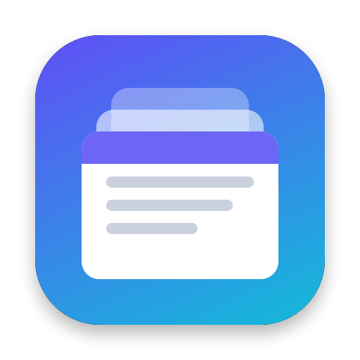
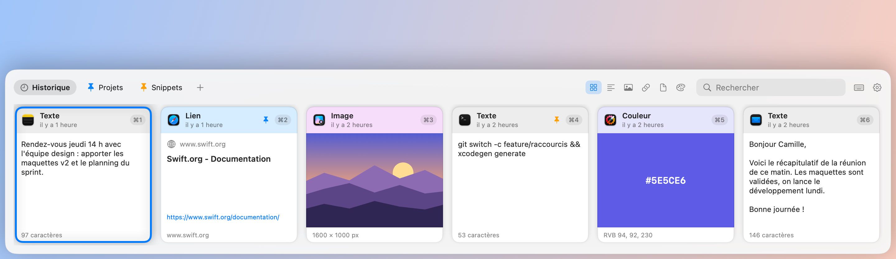
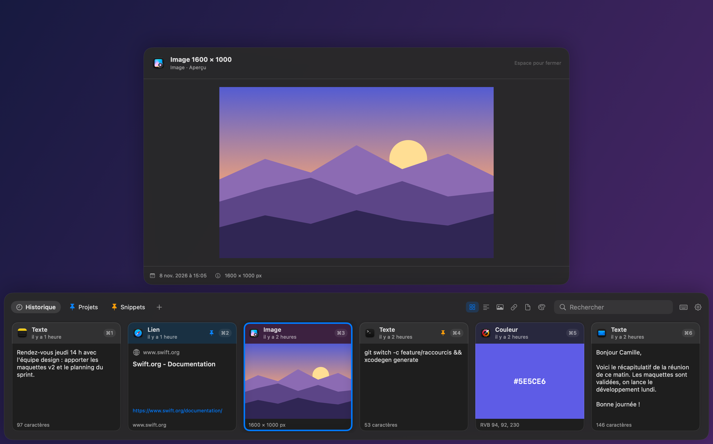

<p align="center">
  
</p>

<h1 align="center">Copicol</h1>

<p align="center">
  <strong>A native, open-source clipboard manager for macOS.</strong><br>
  Everything you copy, one shortcut away.
</p>

<p align="center">
  <a href="https://github.com/romainrg/Copicol/actions/workflows/ci.yml"></a>
  <a href="https://github.com/romainrg/Copicol/releases/latest"></a>
  
  <a href="LICENSE"></a>
</p>

<p align="center"><a href="README.fr.md">Version française</a></p>

<picture>
  <source media="(prefers-color-scheme: dark)" srcset="docs/images/shelf-dark.png">
  
</picture>

Copicol keeps a history of everything you copy (text, images, links, files, colors) and brings it back with <kbd>⇧</kbd><kbd>⌘</kbd><kbd>V</kbd>: a shelf of cards slides up from the bottom of the screen, you pick one, and it is pasted straight into the app you were using.

> [!NOTE]
> The interface is currently in **French only**. English localization is the first item on the [roadmap](#roadmap), and help is welcome.

## Features

- **Captures everything you copy**: plain and rich text (RTF/HTML), images (PNG/TIFF), files, web links (with page title and icon) and colors (`#RGB`, `#RRGGBB`, `#RRGGBBAA`, or a color copied from a color picker). Copying something again moves it back to the top instead of duplicating it.
- **Shelf**: a panel that slides up from the bottom (or the left or right edge) of the active screen. Move with the arrow keys, paste with <kbd>↩</kbd> or with <kbd>⌘1</kbd>…<kbd>⌘9</kbd>.
- **Direct paste** into the app you were using, as-is or as plain text (<kbd>⇧↩</kbd>). Prefer to paste yourself? Switch to *copy only* mode.
- **Instant search** across text, link titles, URLs, file names and source apps, ignoring case and accents, with filters by type.
- **Pinboards**: color-coded tabs for snippets you want to keep. Drag a card onto a tab to pin it; pinned items are never purged.
- **Preview** any item in large with <kbd>Space</kbd>, **drag** cards into any app, or share them through the system share menu.
- **Private by design**: everything stays on your Mac, with no account and no analytics. Passwords flagged by password managers are never recorded, and copies made in 1Password, Bitwarden, Keychain Access or Passwords are ignored (the list is configurable).
- **Native and lightweight**: Swift, SwiftUI and AppKit, sandboxed, universal binary (Apple Silicon and Intel), no third-party dependencies.
- **Optional iCloud sync** of pinboards and small text items between your Macs, for builds signed with an Apple developer team (see [Architecture](docs/ARCHITECTURE.md#icloud-sync)).

<p align="center">
  
</p>

## Install

1. Download `Copicol-<version>.zip` from the [latest release](https://github.com/romainrg/Copicol/releases/latest) and unzip it.
2. Move `Copicol.app` to your `Applications` folder and open it.
3. Copicol is not notarized by Apple yet, so macOS blocks the first launch. Open **System Settings › Privacy & Security**, scroll down and click **Open Anyway** next to the message about Copicol. Alternatively, run:

   ```sh
   xattr -dr com.apple.quarantine /Applications/Copicol.app
   ```

4. Follow the welcome window to allow **Accessibility**, which Copicol needs to paste into other apps. Copicol lives in the menu bar: it has no Dock icon.

Each release includes a checksum file: `shasum -a 256 -c Copicol-<version>.zip.sha256` verifies your download.

> [!IMPORTANT]
> Until Copicol is signed with a Developer ID, macOS ties the Accessibility permission to each build. **After an update**, remove Copicol from System Settings › Privacy & Security › Accessibility (with the − button) and allow it again.

**Requirements:** macOS 14 Sonoma or later.

## Usage

| Shortcut | Action |
|---|---|
| <kbd>⇧⌘V</kbd> (configurable) | Open or close the shelf |
| <kbd>←</kbd> <kbd>→</kbd> <kbd>↑</kbd> <kbd>↓</kbd> | Move between cards |
| <kbd>↩</kbd> | Paste the selected item |
| <kbd>⇧↩</kbd> | Paste as plain text |
| <kbd>⌘1</kbd> … <kbd>⌘9</kbd> | Paste the n-th item (add <kbd>⇧</kbd> for plain text) |
| <kbd>Space</kbd> | Large preview |
| <kbd>⌦</kbd> (<kbd>fn</kbd> <kbd>⌫</kbd>) or <kbd>⌘⌫</kbd> | Delete the item (<kbd>⌫</kbd> alone always edits the search) |
| <kbd>⌘C</kbd> | Copy without pasting |
| <kbd>⌘F</kbd> or just type | Search |
| <kbd>⇥</kbd> / <kbd>⇧⇥</kbd> | Next / previous tab |
| <kbd>⎋</kbd> | Close the preview, clear the search, then close the shelf |

Right-click a card to paste it, copy it, pin it to a pinboard, share, preview or delete it. Double-click a pinboard tab to rename it; right-click it to change its color or delete it. The menu bar icon lets you open the shelf, pause capture, clear the history and open the settings.

### Permissions

| Permission | Why | Where |
|---|---|---|
| **Accessibility** | Simulate <kbd>⌘V</kbd> in the active app (direct paste). Not needed in *copy only* mode. | System Settings › Privacy & Security › Accessibility |
| **Login item** | Launch Copicol when you log in (Settings › Général). | System Settings › General › Login Items, if macOS asks |
| **Pasteboard access** | Recent macOS versions may ask before an app reads the clipboard. | Allow Copicol in the prompt |

The global shortcut and closing the shelf on an outside click need no permission.

## Privacy

- Your history is stored only on your Mac, in Copicol's sandbox container (`~/Library/Containers/io.github.romainrg.Copicol/`).
- The only network requests are link previews: when you copy a link, Copicol loads that page's title and icon with Apple's LinkPresentation framework, as Messages does. There is no analytics, telemetry or crash reporting.
- Clipboard contents are never written to logs.
- Content that other apps mark as concealed or transient (passwords, for instance) is never recorded. You can pause capture at any time from the menu bar.
- iCloud sync is off by default and only exists in builds signed with an Apple developer team; when enabled, it uses your private iCloud database.

## Build from source

Requirements: macOS 14 or later, Xcode 16 or later and [XcodeGen](https://github.com/yonaskolb/XcodeGen).

```sh
brew install xcodegen
git clone https://github.com/romainrg/Copicol.git
cd Copicol
xcodegen generate
xcodebuild -project Copicol.xcodeproj -scheme Copicol -configuration Debug -derivedDataPath build build
open build/Build/Products/Debug/Copicol.app
```

Run the tests with `xcodebuild test -project Copicol.xcodeproj -scheme Copicol -derivedDataPath build -destination 'platform=macOS'`. [CONTRIBUTING.md](CONTRIBUTING.md) is the full development guide, and [docs/ARCHITECTURE.md](docs/ARCHITECTURE.md) explains how the app works.

## Contributing

Bug reports, fixes, features, documentation and translations are welcome. Please read [CONTRIBUTING.md](CONTRIBUTING.md) and the [Code of Conduct](CODE_OF_CONDUCT.md) first. If you work with an AI coding agent, point it to [AGENTS.md](AGENTS.md).

Found a security issue? Please report it privately, as described in [SECURITY.md](SECURITY.md).

## Roadmap

- English localization (the interface is French-only today).
- Developer ID signing and notarization, for an install without Gatekeeper warnings.
- Homebrew cask.
- Mac App Store release.
- Dragging several files at once into other apps.

Ideas and feedback are welcome in the [issues](https://github.com/romainrg/Copicol/issues).

## License

Copicol is released under the [MIT License](LICENSE).
